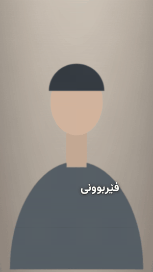
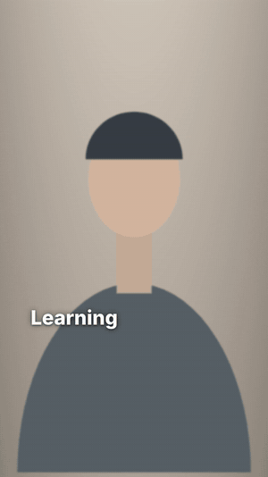
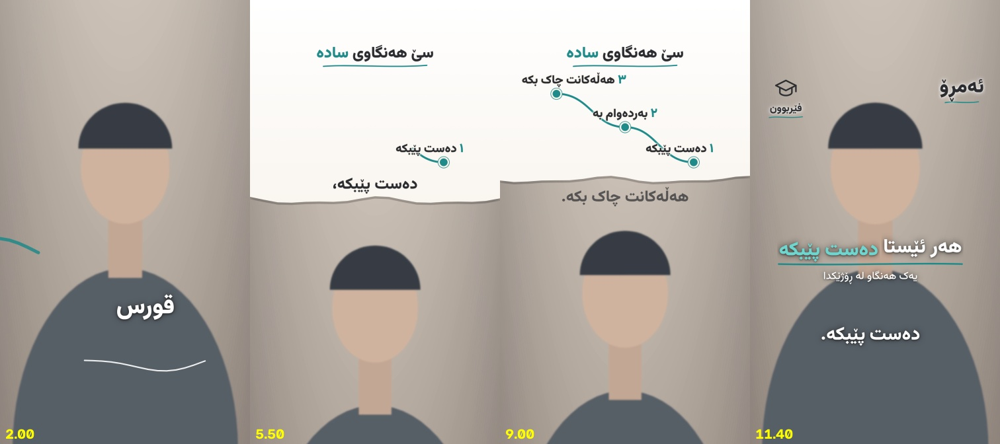
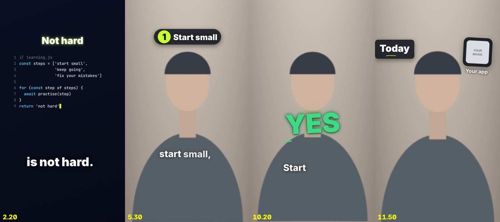
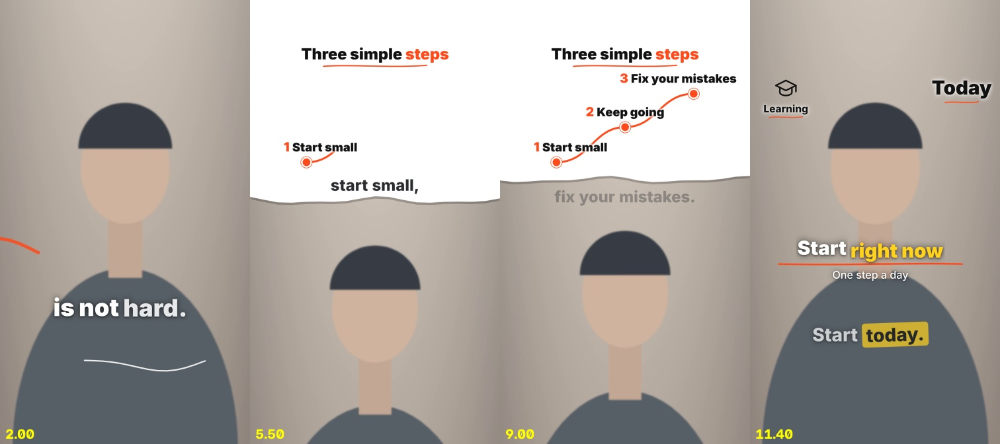

# Talking-head reel kit

Turn a raw talking-to-camera video into a finished vertical reel (Instagram Reels, TikTok, Shorts) with code instead of a timeline editor:

1. **Clean cut**: remove restarts, repeated takes and long pauses without clipping word endings.
2. **Subtitles**: word-timed, animated, from a speech-to-text JSON.
3. **Motion graphics**: flowing ribbons, drawn lines, split screens, titles, rendered from an HTML page with transparency.
4. **Sound**: voice polish and quiet synthesized sound effects.
5. **Export**: 1080x1920, composited with ffmpeg.

<p>


</p>

*Demo renders over a placeholder figure (your video goes there). Yellow numbers on the stills below are seconds.*

It works for **right-to-left and left-to-right languages**. It was built for **Kurdish Sorani** (Vazirmatn typeface, Sorani transcript fixes) and ships with a Sorani demo and an English demo. One setting in `graphics/config.js` switches direction and font, so Arabic, Persian or any other language is a font and a fixes file away.

It is designed to be driven by an AI coding assistant (see `skill/SKILL.md`, a ready-made skill for Claude), but every step is a plain script you can run yourself.

## Requirements

- ffmpeg 4.4 or newer
- Python 3.10+ with `numpy`, `scipy`, `opencv-python`, `playwright` (`pip install numpy scipy opencv-python playwright && playwright install chromium`, or set `CHROME=/path/to/chrome`)
- Node/npm (only to install the fonts)
- A word-level transcript. The scripts read the JSON export of ElevenLabs Speech to Text (which supports Central Kurdish); any `{text, start_time, end_time}` word list works.

## Try the demo (no video needed)

```
cd graphics
npm install
python3 ../subs/chunks.py example/ckb/transcript.json work --fixes ../subs/fixes.ckb.example.json --sizes 3,2,2,3,2,2,3,1,2
python3 shot.py sheet.jpg 0.1 2 4 5.5 7.9 10.2 11.4
```
`sheet.jpg` shows the graphics at those seconds over a grey background.

English demo: copy `example/en/config.js` and `example/en/timeline.js` over the ones in `graphics/`, then
```
python3 ../subs/chunks.py example/en/transcript.json work --fixes ../subs/fixes.en.example.json
python3 shot.py sheet_en.jpg 2 5.5 9 11.4
```
(`example/ckb/` holds the Sorani originals to copy back.)

## Designs

Pick a look with one line in `graphics/config.js`; every component and the subtitles restyle themselves.

| `THEME` | Look |
|---|---|
| `'flow'` | Soft paper panels, hand-drawn lines, text straight on the wall, no boxes. Calm, editorial. |
| `'night'` | Dark panels, neon accents with glow, notes and markers on dark cards. Tech, product, coding. |
| `'punch'` | White panels, heavy type, a highlighter box behind key subtitle words. Loud, fast, opinionated. |

**flow** (Sorani demo)


**night** (English showcase demo)


**punch** (English demo)


`PALETTE` overrides any colour of the chosen design (for example your brand's two accent tones).

Components (all work in every design and in both text directions):

| Component | What it does |
|---|---|
| `ribbon` | flowing line across the frame |
| `note`, `word` | icon/label or a single emphasised word beside the head |
| `stepMarker` | numbered marker above the head |
| `bigWord` | huge word in front of the speaker, `kind:'yes'` / `'no'` for verdicts |
| `lowerThird` | two-part title with a small line on the chest area |
| `image`, `logoCard` | your own image or logo, on a glow or on a card with a label |
| split screen: `steps`, `panelHeadline`, `slide` | content in the panel that covers the top while the speaker shifts down |
| takeover: `codeWall`, or anything added to `TKC[i]` | full-screen scene, e.g. code typing itself |

`example/showcase/` demonstrates the ones the basic demos don't use: copy its `config.js` and `timeline.js` into `graphics/`, build the words from its `transcript.json`, and try each `THEME`.

## Language setup

In `graphics/config.js`:
```js
const TEXT={dir:'rtl', font:"'Vazirmatn','Space Grotesk'"};   // Kurdish, Arabic, Persian
const TEXT={dir:'ltr', font:"'Inter'"};                        // English and other left-to-right languages
```
`dir` sets the reading direction of subtitles and every text component, and mirrors the step path so it runs the way people read. For another typeface, install it (`npm install @fontsource/<name>`), link its CSS in `scene.html`, and name it in `font`. Mixed text is handled: Latin loanwords inside RTL lines keep their place and lose stray punctuation.

## The full workflow

All times are seconds; cuts are stored as **frame numbers of the source**. Replace `30000/1001` with your frame rate (check with ffprobe).

### 1. Clean cut (`cut/`)
```
ffmpeg -i source.mov -vn -ac 1 -ar 16000 -c:a pcm_s16le a16.wav
ffmpeg -i source.mov -vn -ar 48000 -c:a pcm_s16le a48.wav
ffmpeg -i source.mov -an -vf scale=540:-2 -c:v libx264 -crf 28 -preset veryfast proxy.mp4

python3 cut/envelope.py a16.wav env.json
python3 cut/segments.py env.json -48 0.25          # list the speech stretches
python3 cut/repeats.py a16.wav segments.json        # optional: find repeated takes by sound
```
Write the stretches you keep to `clips.json` (`[[start,end], ...]`, rough seconds are fine), then:
```
python3 cut/bounds.py env.json clips.json cuts.json        # exact cuts, word endings protected
python3 cut/preview.py proxy.mp4 a48.wav cuts.json preview.mp4   # numbered preview + table
python3 cut/export_clips.py source.mov cuts.json clips_out       # full quality, resumable
ffmpeg -f concat -safe 0 -i clips_out/list.txt -c copy clean_video.mp4
python3 cut/cut_audio.py a48.wav cuts.json clean_audio.wav
```
**The word-ending rule.** Many speakers let the last word of a sentence fade out. `bounds.py` treats the sound as finished only when the level stays under -72 dB for 100 ms, then adds 0.22 s after it and 0.12 s before the next onset. Cutting on a simple loudness threshold clips those endings.

When a line was said several times, keep the last clean take. If the transcript is not available yet, `repeats.py` finds stretches that contain the same audio.

### 2. Subtitles (`subs/`)
Transcribe the **clean** audio (so times match the video you animate), export the word-level JSON, then:
```
python3 subs/chunks.py transcript.json graphics/work --fixes subs/fixes.json
```
Proof-read `graphics/work/subs.txt`. Speech-to-text repeats the same mistakes, especially for Sorani; put your corrections in a fixes file (`subs/fixes.ckb.example.json` and `subs/fixes.en.example.json` show the format: character normalisation such as Arabic ي/ك to Kurdish ی/ک, whole-word replacements, context fixes, highlighted and "hero" words). For the best rhythm pass `--sizes` with hand-picked words per line: 1 to 4 words, break at commas and breaths, keep a noun with its adjective.

### 3. Graphics (`graphics/`)
The page is deterministic: `renderAt(t)` sets every element from the time alone, so any frame can be rendered in any order.

- `config.js`: design (`THEME`), text direction and font, optional palette override, split-screen intervals (`HALF`), full-screen takeovers (`TK`), slow zooms (`ZOOMS`), jump-cut times (`CUTS`), subtitle heights.
- `timeline.js`: what appears when. Components from `lib.js` (see Designs above), plus the low-level `add(html, css, fn)` for anything custom.
- `finish.js`: subtitles and the driver.

```
python3 shot.py sheet.jpg 1 5 9 --video ../proxy_of_clean.mp4   # check stills first, every scene
python3 render.py 0 900 g0 &                                     # then render, in parallel parts
python3 render.py 900 1800 g1
```
`render.py` writes `work/<tag>_rgb.mp4` (colour) and `work/<tag>_a.mp4` (alpha). `shot.py` also writes `work/xform.json` (zoom and shift of the speaker video) and `work/sfx_events.json`.

Bring your own images and logos (`image('path.png', start, end)`); none are included.

### 4. Composite (`compose/`)
```
python3 compose/comp.py --video clean_video.mp4 --rgb graphics/work/g0_rgb.mp4 --alpha graphics/work/g0_a.mp4 \
        --xform graphics/work/xform.json --f0 0 --f1 900 --out e0.mp4
python3 compose/comp.py ... --rgb g1_rgb.mp4 --alpha g1_a.mp4 --f0 900 --f1 1800 --out e1.mp4
printf "file 'e0.mp4'\nfile 'e1.mp4'\n" > list.txt && ffmpeg -f concat -safe 0 -i list.txt -c copy video_only.mp4
```

### 5. Sound (`sound/`)
```
sh sound/voice.sh clean_audio.wav voice_pro.wav
python3 sound/sfx.py graphics/work/sfx_events.json sfx.wav <duration>
sh sound/voice.sh mix video_only.mp4 voice_pro.wav sfx.wav final_reel.mp4 <duration>
```
The result lands around -14 LUFS. All effects are synthesized, so there is nothing to license.

## Design notes

- **Safe zones (1080x1920):** keep the top ~220 px and the bottom ~420 px clear, and the right edge (x > 940) between y 900 and 1500, where the app draws its buttons. Subtitles sit at y 1330, or y 800 in split-screen mode.
- **Leave the speaker alone.** Background removal on phone footage frays around hands and hair; putting graphics "behind" the person looks cheap. Put graphics beside the head, on the chest area, or in a split panel.
- **Flow over pop.** Lines that draw on, masks that reveal, slow drifts and gentle push-ins read as edited by a person. Boxes, pills and neon glows on everything read as a template.
- **Split screens** suit lists and explanations; full-screen takeovers work once or twice per video.
- **First frame:** the first subtitle is visible from frame 0 so the cover frame has text.
- **Sound effects** should be barely noticed: one per large movement, none on ordinary subtitle changes.

## Pitfalls already solved here

- Seeking (`-ss`) a concat-demuxer input in ffmpeg can drop the first second of an overlay. `comp.py` takes each layer part as a plain input.
- `scale`/`crop`/`overlay` with integer positions make slow zooms shimmer. `comp.py` zooms with the `perspective` filter at sub-pixel precision.
- Web fonts load lazily per script subset, so the first frames can render without text. `render.py` plays the whole timeline once before capturing.
- Premultiplied alpha brightens edges after YUV conversion. Layers are stored as straight colour plus a separate alpha video.

## Licence

MIT, see `LICENSE`. Fonts are installed from npm under their own licences (Vazirmatn, Inter, Space Grotesk and JetBrains Mono: SIL Open Font License).
